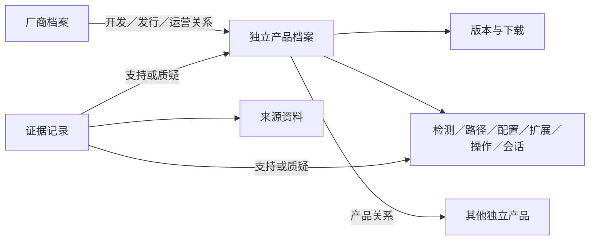

# harnesses 总体需求设计方案

版本 0.2 · 2026-11-13 · 讨论稿

正式产品名称为 `harnesses`，域名为 `harnesses.top`（用户已购买）。归档目录沿用原工作名称 `harness-registry`。本文用于确认总体需求与设计方向。

## 1. 产品目标与已确认需求

建立面向用户、开发者和 AI Agent 的公开 harness 资料库。消费者可以查清产品身份、官方入口、平台与版本条件、本机识别规则、扩展接入方式和操作接口，并追溯资料依据。

用户已确认以下方向。

1. 收录目标覆盖所有可识别、可追溯的 AI Harness，涵盖 CLI、桌面、IDE 扩展、云端和自托管产品，兼顾不同厂商、地区与发布形式。产品身份得到核验即可逐步补充档案，尚缺的资料按未知或待核验记录。
2. 每个独立产品独立建档。WorkBuddy 与 WorkBuddy AI 分别拥有 ID 和产品页，可以关联同一厂商。
3. 厂商拥有独立资料页，展示详细信息、官方入口和旗下产品。
4. 资料可以拆分存储，以稳定 ID 关联，同时提供完整 JSON 下载。
5. 消费者通过托管网页、HTTP API、远程 MCP 直接使用服务。
6. 服务提供资料、识别规则和操作说明。本机扫描、安装扩展、修改配置和调用 harness 由接入方执行。
7. 官网、文档、官方软件下载入口等属于核心资料。
8. 网站参考 models.dev 的搜索和表格体验，产品详情按信息领域分区。
9. 网站提供浅色与深色外观。星空可作为视觉探索方向。
10. 首版支持中文与英文，国际化结构支持后续增加语言。
11. 提供 Docs 文档、GitHub 仓库入口、搜索框与品牌 Logo；实际 GitHub 仓库地址待确定。
12. 首页突出产品用途和使用方式，包含可交互内容与滚动动效，参考已有项目但保持原创设计。

其他设计均为基于上述方向提出的建议。技术栈、数据许可、首发产品名单和运营指标在后续阶段确定。

## 2. 用户与场景

| 用户 | 使用目标 | 交付信息 |
| --- | --- | --- |
| 普通用户 | 找官网、下载、文档和同厂商产品 | 产品与厂商档案、官方链接、平台和渠道 |
| Skill／插件作者 | 确认兼容范围和安装方式 | 扩展格式、目录、注册、启用、版本限制和验证方法 |
| 安装器开发者 | 准确识别本机产品及版本 | 检测信号、歧义条件、版本读取方法和条件化路径 |
| Agent | 找到另一个 harness 的操作入口 | CLI／SDK／协议说明、输入输出、前置条件和失败语义 |
| 会话工具作者 | 定位、读取和恢复会话 | 存储位置、格式、解析器参考、恢复说明 |
| 团队维护者 | 处理升级、配置诊断和迁移 | 版本差异、废弃规则、兼容性和变更记录 |
| 贡献者 | 补录、纠错与验证 | 数据规范、来源要求、自动检查与审核反馈 |

### 2.1 扩展安装

接入方获取注册表 → 在本机按规则收集有限信号 → 判断产品与版本 → 查询匹配的扩展规则 → 生成安装方案 → 接入方执行并验证。

资料需要覆盖目录、作用域、格式、软链接、注册、启用、信任要求、重载和成功判据。检测结果能表达发现程序、仅发现数据目录、多个候选和版本未知等情况。

### 2.2 跨 harness 调用

Agent 查询满足能力条件的产品 → 接入方确认目标可用 → 获取指定版本及平台的调用说明 → 接入方启动 → 按协议读取结果、取消或恢复会话。

资料需要覆盖参数、工作目录、输入渠道、输出格式、退出状态、超时、取消、模型选择和会话标识。

### 2.3 扩展场景

- 跨工具扩展发布与兼容性声明。
- 新电脑恢复配置、跨平台迁移和团队环境差异检查。
- 升级前发现路径、配置、调用参数或扩展能力的变化。
- 解释配置覆盖、MCP 加载失败和 Skill 扫描问题。
- 会话历史检索、恢复入口和跨工具交接。
- 按能力和运行条件选择工具。
- 查询日志、缓存、会话等用途，辅助空间管理。
- 订阅产品或特定字段的变化。

## 3. 数据组织与方案选择

| 组织方式 | 特点 | 本方案取舍 |
| --- | --- | --- |
| 直接维护大型 JSON | 初期直观，多人修改和审核成本随规模上升 | 完整 JSON 用于发布和离线消费 |
| 分实体分模块维护，构建关联快照 | 便于贡献、验证、审阅和多入口发布 | 建议作为基础方案，符合已确认的拆分关联方向 |
| 数据库作为编辑主存储 | 便于编辑后台与权限流程，需维护编辑审计系统 | 后续按规模评估，保持发布契约兼容 |

建议维护源采用 JSON，以 JSON Schema 校验。构建过程生成关联校验结果、搜索索引、产品完整视图、厂商视图和全量快照。查询服务可以用数据库或搜索引擎承载派生索引。

### 3.1 产品身份与关系

- 独立发布、品牌或官方明确区分的产品建立独立条目。共用内核或兼容目录的关系另行记录。
- WorkBuddy 与 WorkBuddy AI 必须分开建档。真实厂商、发行方与官方入口在录入时核验。
- 操作系统、CPU 架构通常作为规则条件。CLI、桌面、IDE 扩展等用形态字段表达；官方作为独立产品发布的形态单独建档。
- 地区版按真实产品身份判断是否独立。存在争议时记录依据并审核。
- ID 长期稳定，名称和别名可变化。误合并或误拆分保留迁移记录、替代 ID 和历史快照。
- 厂商关系可以表达开发者、发行商、运营方和母公司，并记录有效时间。厂商页的产品列表由关联反向生成。

### 3.2 实体模型

| 实体 | 关联 | 主要资料 |
| --- | --- | --- |
| Vendor | 稳定 `id` | 厂商身份、名称、Logo、简介和官方入口 |
| Harness | 稳定 `id`、`vendor_relations` | 产品身份、简介、形态、状态、链接及模块引用 |
| VendorRelation | `vendor_id`、角色、有效时间 | 产品对应的开发、发行、运营等主体 |
| ProductRelation | 两端 `harness_id`、关系类型 | 系列、前身、继任者、分支、兼容性 |
| Release | `id`、`harness_id` | 上游版本、渠道、发布时间与更新说明 |
| Download | `id`、`harness_id`、可选 `release_id` | 下载入口、平台、架构、渠道与校验资料 |
| Rule | `id`、`harness_id`、适用条件 | 检测、路径、配置、扩展、调用或会话规则 |
| Source | `id` | 来源 URL、类型、采集日期、固定提交或版本定位 |
| Evidence | `id`、目标实体／字段／规则和来源引用 | 结论、验证方法、环境、日期及争议记录 |

多角色厂商关系允许多个主体，产品页可以指定主要展示厂商。稳定关系仅维护一次，各方向的查询由关联生成。



### 3.3 存储示意

```text
data/
  vendors/<vendor-id>.json
  harnesses/<harness-id>/
    product.json
    releases.json
    downloads.json
    detection.json
    paths.json
    configuration.json
    extensions.json
    operations.json
    sessions.json
    capabilities.json
  sources/<source-id>.json
  evidence/<evidence-id>.json
schemas/
```

无资料的模块允许缺省，在发布视图中标记未知。完整 JSON 包含 `schema_version`、`snapshot_id`、`published_at` 以及全部实体集合，内部引用闭合。单产品响应可以展开相关实体，同时保留 ID 和证据引用。

## 4. 资料范围

| 模块 | 收录内容 |
| --- | --- |
| 产品身份 | 名称、别名、旧名称、简介、厂商、类型、地区、开源情况、许可证、维护状态 |
| 官方入口 | 官网、文档、代码仓库、发行页、更新日志、帮助中心、反馈、社区和服务状态 |
| 获取安装 | 下载页、各平台和架构资源、包管理器包名、安装说明、系统要求、渠道 |
| 版本 | 上游版本、发布时间、生命周期、已验证版本、升级迁移和破坏性变化 |
| 账号服务 | 登录方式、地区条件、官方套餐入口、自带 Key 支持和企业部署入口 |
| 本机识别 | 命令名、包名、应用标识、进程、目录、版本读取方法、冲突与残留说明 |
| 路径数据 | 配置、会话、日志、缓存、临时文件、扩展、凭据存储机制及覆盖变量 |
| 配置体系 | 格式、字段、作用域、优先级、合并规则、重载方式、官方 schema |
| 扩展接入 | Skills、MCP、Hooks、插件、Commands、Subagents 的格式和生命周期 |
| 调用控制 | CLI、SDK、HTTP API、ACP、MCP、深链接等入口、参数、输入输出、取消和恢复 |
| 会话上下文 | 数据结构、版本差异、查询、恢复、分叉、导入导出与解析器参考 |
| 能力限制 | 平台、模型接入、工具、结构化输出、流式输出、沙箱、并发和远程运行 |
| 运行维护 | 日志定位、诊断方式、故障资料、迁移要求、进程与服务信息 |
| 关联兼容 | 产品系列、历史关系、格式兼容和已验证的互操作方式 |
| 证据 | 来源、环境、核验日期、验证方式、冲突和历史变化 |

凭据相关资料记录变量名、存储机制和位置约定，示例使用占位符。

下载资料同时收录官方稳定下载页与具体版本资源，标注平台、架构、渠道、校验值或签名、最后检查日期及链接状态。登录和地区限制以条件表达。失效资源保留历史状态。

## 5. 条件与证据规则

### 5.1 条件匹配

规则可依赖操作系统、架构、形态、渠道、版本、作用域和环境变量。路径以 `{home}`、`{project_root}` 等占位符表示，并声明变量缺失时的回退顺序。

保留上游原始版本字符串。确认遵循语义化版本时使用相应区间，其他版本采用精确匹配或有明确定义的比较策略。版本未知时返回候选和缺失条件。

查询先匹配产品，再匹配全部已提供条件。零匹配返回明确状态及相关版本资料。规则重叠时，存在有依据的替代或优先级关系才能选定，否则返回冲突列表。

### 5.2 状态与可信度

能力状态建议采用 `supported`、`conditional`、`unsupported`、`unknown`、`deprecated`。兼容实现另存实现类型与限制。

来源类型、验证方法、验证状态分别记录。官方文档、官方源码、发布物实测与社区记录可独立识别。字段或规则必须能关联证据；实测记录需包含版本、平台、方法和结果。来源冲突、过期和待验证可查询。资料缺失以未知表示。

### 5.3 检测规则

描述有范围的检查，例如 PATH 中的命令、包元数据、应用标识和特定文件结构。记录信号强弱、组合条件、共享信号及容易混淆的产品。

首版提供检测规则查询。后续可增加特征匹配接口，接受接入方已采集的最少信息并返回候选和匹配依据。公共资料中的事实标记为 `catalog` 来源，本机是否存在、是否登录和是否可用由接入方验证。

### 5.4 操作规则

每项操作包含目的、适用条件、前置条件、入口、参数、输入输出、可能改动、成功判据、错误及取消语义。CLI 优先用参数数组和占位符表达。可附官方 SDK、协议和适配器参考链接。

托管服务负责检索和资料解析。操作描述作为数据返回，由接入方按自己的环境和授权执行。

## 6. 发布、API 与 MCP

### 6.1 统一快照

`schema_version` 表示数据结构契约，`snapshot_id` 表示资料内容版本，上游产品版本独立记录。消费者可锁定不可变快照或读取最新快照。

发布清单包含文件路径、字节数、摘要、条目数和 schema 版本。完整 JSON 支持压缩、缓存、ETag 和条件请求。变更记录表达新增、修改、废弃和关系修正。

全部产物构建校验成功后原子切换最新指针。分页游标绑定快照和筛选条件。发布失败继续提供最近成功快照。搜索、网页、API 与 MCP 读取同一已发布快照。

### 6.2 HTTP API 草案

| 入口 | 内容 |
| --- | --- |
| `GET /api/v1/catalog.json` | 完整 JSON |
| `GET /api/v1/snapshots/{snapshot_id}/catalog.json` | 固定历史快照 |
| `GET /api/v1/vendors` | 厂商搜索和分页 |
| `GET /api/v1/vendors/{id}` | 厂商资料 |
| `GET /api/v1/vendors/{id}/harnesses` | 关联产品，支持角色筛选 |
| `GET /api/v1/harnesses` | 产品搜索、能力与平台筛选 |
| `GET /api/v1/harnesses/{id}` | 产品档案，支持模块选择与关联展开 |
| `GET /api/v1/harnesses/{id}/rules` | 条件化规则查询 |
| `GET /api/v1/harnesses/{id}/downloads` | 官方入口及下载资源 |
| `GET /api/v1/changes` | 快照之间或指定产品的变化 |
| `GET /api/v1/sources/{id}` | 来源及关联验证资料 |

通用参数建议为 `snapshot`、`q`、`fields`、`include`、`cursor`、`limit`，具体适用范围由 OpenAPI 定义。规则支持 `platform`、`arch`、`version`、`surface`、`channel` 和 `scope`。响应包含快照、匹配条件、证据和未解决问题。

精确 ID 查询确定性返回。搜索支持中英文、别名、包名和关键词，优先精确 ID／名称，其次别名，再匹配正文。能力筛选默认仅计入已确认满足条件的结果，可显式包含条件支持和未知项。

稳定错误码覆盖产品不存在、零匹配、规则冲突、参数无效、快照不可用和请求限流。响应给出修正查询的依据。

基础页面、下载和资料查询建议公开访问。API Key 可用于额度和服务等级，正式额度和认证细节在部署阶段确定。

### 6.3 远程 MCP 草案

托管服务通过 Streamable HTTP 提供查询，兼容客户端添加服务地址即可接入。

| 工具 | 返回内容 |
| --- | --- |
| `search_harnesses` | 候选、关键字段与匹配原因 |
| `get_harness` | 产品档案与指定模块 |
| `get_vendor` | 厂商及旗下产品 |
| `get_detection_rules` | 检测规则和歧义说明 |
| `get_extension_rules` | 扩展接入规则 |
| `get_operation` | 操作说明 |
| `get_downloads` | 条件匹配的官方下载入口 |
| `compare_harnesses` | 同字段同条件的对照 |
| `get_changes` | 产品或字段变化 |

工具声明只读，返回结构化资料、精简解释、来源、快照和缺口。提供字段选择与分页，控制结果体积。MCP 与 HTTP API 在同条件同快照下给出一致结论。站点可提供由相同数据生成的 Agent 易读 Markdown 页面。

## 7. 网站信息架构

### 7.1 首页

首页先介绍覆盖范围、档案字段和数据接入方式。首屏提供目录、JSON、API 和 MCP 入口，目录紧接首屏。使用示例展示如何用资料定位配置、适配扩展或调用另一个 Harness，并链接到原始来源。

页面按数百个产品设计。全站搜索接受产品名、别名、ID、厂商和已收录的字段，精确匹配优先，结果数量超出显示上限时给出总数和缩小范围的提示。完整目录提供筛选和分页，可使用同一快照的索引处理查询。规则对照作为使用示例，提供可搜索的产品选择器、来源、复制和当前结果的 JSON 导出。

产品目录参考 models.dev 的查询效率，提供可搜索、筛选和排序的产品表格。默认列为产品、厂商、类型、平台、关键能力、维护状态和资料更新时间。

提供概览、扩展接入、调用控制、会话数据和资料质量等列视图。搜索覆盖厂商及产品并标记类型。筛选、排序与视图写入 URL，便于分享。

主要入口为厂商目录、产品比较、JSON 下载、API 文档、MCP 接入、变更与贡献指南。收录数量和核验覆盖度分别展示。

### 7.2 产品页

页头展示名称、厂商链接、简介、状态、官网、下载及文档。主体按第 4 节模块组织，平台、形态、渠道和版本选择影响适用资料。每条规则可展开来源与验证信息。

缺少匹配资料时展示缺口与候选，历史版本保留所选条件。分享链接可定位具体模块和版本。

### 7.3 厂商页

展示名称、别名、Logo、简介、官方入口与主体关系。旗下产品可以按类型、地区、平台、角色和状态筛选。WorkBuddy、WorkBuddy AI 分别显示卡片并进入独立页面。

聚合旗下产品的更新，关系带角色与有效时间以表达收购、改名或运营方变化。

### 7.4 其他页面

- 比较页按相同条件并排展示多个产品，保留未知及条件支持状态。
- 开发者页包含 schema、JSON、OpenAPI、MCP 配置、快照与兼容说明。
- 贡献页提供新增厂商／产品、来源补录、纠错与测试样本流程。
- 变更页按产品、模块和时间筛选，并提供固定链接。

首页重点表达资料用途和使用方式，目录使用数据密集表格，详情使用分区档案。浅色和深色贯穿全部页面；首版中英文覆盖界面和 Docs，保留扩展语言的结构。色彩、字体、Logo 及交互原型在界面设计阶段确定。

## 8. 数据维护与质量

贡献流程为提交资料 → schema 和引用校验 → 来源及适用条件审阅 → 已实测声明的验证记录检查 → 合并 → 构建 → 发布。

最小产品条目包含稳定 ID、名称、类型、一个可追溯官方入口、身份依据和资料状态。厂商未知时显式表达，后续补充。

检测规则、配置写入说明、调用参数和下载入口需有可复核来源。自动采集和 AI 提取用于生成候选，保留待核验状态。验证环境与工具版本必须可追溯。

定期检查官方发布、文档和下载链接。新版本出现时明确标记覆盖缺口，旧规则保留适用版本。来源冲突保留双方证据，通过审阅确定有条件的结论。

自动检查覆盖重复 ID、悬空引用、非法版本条件、重叠规则、无效状态和快照引用闭合。历史纠错发布新快照，并为旧快照附已知问题和替代记录。

代码与数据分别确定许可。建议允许商业复用的数据许可，正式许可结合来源内容确定。事实摘要、来源链接和必要示例优先，Logo 等资源遵循厂商要求。

维护者认领、贡献来源和审核记录公开可追溯。页面持续展示资料覆盖与缺口。公共查询通过缓存及限流保障可用性；可选本机特征匹配需约定最少输入和日志保留方式。

## 9. 架构方向

```text
分实体资料 + 来源与验证记录
              ↓
      schema / 引用 / 条件检查
              ↓
         不可变发布快照
         ↙      ↓       ↘
    JSON 下载  查询索引  网页档案
                 ↓
             HTTP API
                 ↓
             远程 MCP
```

发布文件可经 CDN 分发。API、MCP 和网页复用查询与条件解析逻辑，缓存按快照版本区分。查询根据资料确定结果，Agent 将自然语言需求转为明确条件。

语言、框架、搜索引擎和托管服务由后续技术方案选择，满足数据契约、快照一致性及远程可用要求。

## 10. 交付阶段建议

| 阶段 | 产出 | 完成条件 |
| --- | --- | --- |
| 总体设计 | 本文及决策建议 | 用户审阅总体方向 |
| 数据契约验证 | schema 草案、代表性厂商和产品样例 | 表达同厂商独立产品、版本变化、跨平台路径和未知项 |
| 首次公开可用 | 网页、厂商与产品页、JSON、HTTP API、远程 MCP | 任一入口可直接访问并返回同快照的一致资料 |
| 扩展覆盖 | 更多产品、兼容资料、审核和变更比较 | 收录增长同时保持来源与条件可追溯 |
| 持续维护 | 上游变化发现、贡献工作流和变更订阅 | 失效资料及时标记，消费者可锁定并升级快照 |

契约验证建议采用 WorkBuddy、WorkBuddy AI、CodeBuddy、Claude Code、Codex、ZCode、MiniMax Code、OpenCode 等样例。该名单用于检验结构表达能力，首发名单在核验后确定。

首次公开可用的范围建议按以下口径控制：

- 所有已发布产品满足最小条目要求，未补齐的模块显式展示未知。
- 至少一个经过核验的产品贯通“查询检测规则 → 获取扩展接入说明 → 查询加载验证方法”的资料链路；至少一个产品贯通“查询操作入口 → 获取输入输出与成功判据”的资料链路。
- WorkBuddy 与 WorkBuddy AI 的独立身份、厂商关联和各自官方入口作为身份建模的必测案例；尚未核实的事实保持待核验。
- 每种公开入口均可用，比较、变更和贡献流程先提供基础能力；自动采集、变更订阅推送和本机特征匹配服务列为后续增强。

覆盖统计分别展示产品条目数、各模块有资料的比例，以及有适用版本和可复核证据的规则比例。统计明确分母与快照日期，避免把“已收录”解释成“所有资料已核验”。

## 11. 验收标准

1. 同厂商独立产品拥有不同 ID 与页面，厂商及产品可以双向查询。
2. 产品改名后保留 ID 与旧名搜索，历史引用仍可解释。
3. 完整 JSON 可离线解析、内部引用闭合，包含 schema 和快照版本。
4. 网页、API 与 MCP 在同条件同快照下返回一致资料。
5. 按平台、架构和版本找到对应规则和下载资源，零匹配、未知和冲突可区分。
6. 检测规则能表达共享与残留目录、多安装副本等歧义。
7. 未知和不支持在查询、筛选与比较中保持区分。
8. 扩展规则覆盖加载与验证，操作规则覆盖前置条件、输入输出和版本范围。
9. 具体路径或操作可追溯来源、验证环境和日期。
10. 发布过程中分页稳定，失败构建保留最近成功快照，历史快照可读。
11. 远程 MCP 可通过地址接入，具备字段选择和分页。
12. 链接失效、产品废弃、规则冲突和资料过期在页面与接口中可见。
13. schema 变化有兼容策略与迁移说明，内容变化使用独立快照。

延迟、可用性、页大小、访问额度、快照保留与刷新频率的数值，结合样例规模和部署预算在技术方案中确定。

## 12. 设计建议与待定项

本文建议采用 JSON 分文件维护、JSON Schema、不可变快照、字段级证据、条件化解析、公开查询和托管远程 MCP。

正式名称和域名已确认为 `harnesses`、`harnesses.top`。首发产品范围、GitHub 仓库地址、数据许可、维护团队、部署预算及服务指标待后续逐项确定。

## 13. 参考资料

- [models.dev](https://models.dev/) 与 [数据仓库](https://github.com/anomalyco/models.dev) — 分散维护源、关联与多入口发布。
- [@agntn/harnesses](https://harnesses.agntn.dev/) — 路径、证据、调用及配置类别。
- [Vercel skills API](https://github.com/vercel-labs/skills/blob/v1.8.1/docs/api.md) — 识别与扩展路径。
- [AgentsView](https://www.agentsview.io/docs/commands/#agentsview-source-list) — 会话来源与解析能力。
- [deja-vu registry](https://vshulcz.github.io/deja-vu/registry/README.html) — 会话布局、格式和验证记录。
- [WorkBuddy 相关源码](https://github.com/vshulcz/deja-vu/blob/v0.24.2/internal/sources/codebuddy.go) — 不同产品目录的案例。

参考资料来自本次会话的公开文档与源码调研。本文接口、ID 和存储布局为拟议设计，真实产品事实在录入时核验。
